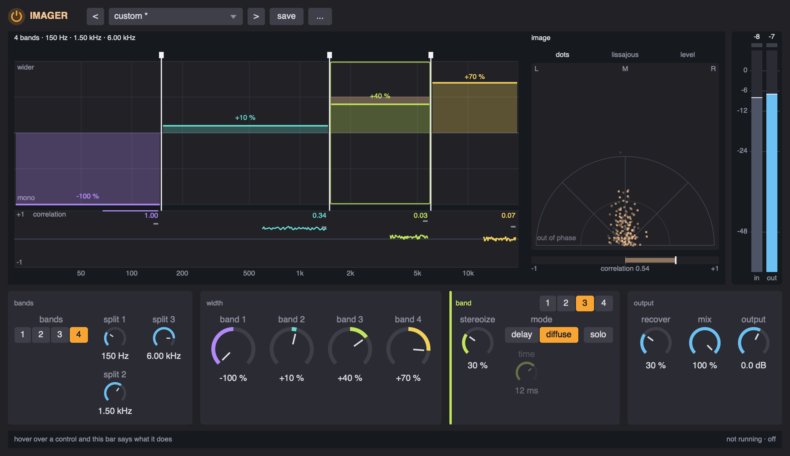

# Imager

**A stereo imager in up to four bands - width, stereoize and recover per band, with the image and each band's correlation drawn live - running anywhere a UGen does, with a window.** A SuperCollider extension.



```supercollider
s.boot;
Ndef(\pad, { Imager.ar(Pan2.ar(Saw.ar([110, 165]).sum * 0.1, LFNoise1.kr(0.3)), \imager) }).play;

p = Imager(Ndef(\pad), \imager);
p.gui;
p.bands = '3'; p.split1 = 150; p.split2 = 3000;
p.width1 = -1;                       // the bass in the middle
p.width3 = 0.5; p.stereo3 = 0.4;     // the top wider, and given more side
p.preset = 'mono bass';
```

Every effect of this family lives in the same three places. Write `Imager.ar` into a graph of your own and drive it from the object, as above; give it a node of its own on a bus, `Imager.onBus(0, 2).enabled_(true)`; or put it in a chain, `FxChain.master.add(Imager())`. If SuperDirtGUI is installed, it is an insert on an orbit too: `~sdg.addInsert(0, \imager)`, listed under *utility*.

It takes its idea from iZotope's Ozone Imager: width per band from mono to twice as wide, a stereoize that gives a band a side it did not have, a recover that keeps the weight of what narrowing takes away, and a vectorscope with its three drawings. The DSP and the window are this family's own.

It is built on [FxKit](../sc%20fx%20kit), which is built on [ParaEQ](../sc%20EQ), and the class library will not compile without them; the installer links both when the folders sit side by side. It uses SuperCollider's own UGens, not sc3-plugins.

Written for SuperCollider 3.13 on macOS. Nothing in it is platform specific apart from the symlink in `install.scd`, which Linux shares and Windows does not.

## Install

### As a quark

```supercollider
Quarks.install("https://github.com/fracnesco/sc-imager.git");
thisProcess.recompile;
```

The manifest names `sc-fx-kit` as a dependency, which names `sc-eq`, so `Quarks` fetches those first. The quark goes by the name of the repository, `sc-imager`; the class inside it is `Imager`.

### From a clone

Clone `sc-eq` into a folder called `sc EQ`, `sc-fx-kit` into `sc fx kit` and this into `sc imager`, side by side. Open `install.scd` and evaluate its first block, then recompile the class library. It links what is missing and tells you what it did.

On Windows there is no `ln -s`, so use the quark, or copy the three folders into the extensions folder by hand: `Platform.userExtensionDir.openOS` opens it.

Install it one way or the other, **not both**: two copies on the class path is a duplicate class error at compile time.

### Check that it took

```supercollider
Imager.presetNames;
Imager.onBus(0, 2).enabled_(true).gui;
```

Select `Imager` and press cmd/ctrl + d for the help file, and see [examples/imager-demo.scd](examples/imager-demo.scd) for a walkthrough you can evaluate a block at a time.

## What it does

A stereo signal is a **middle** and a **side**: `(left + right) / 2` is what both channels share, `(left - right) / 2` what differs between them. Turning the side down narrows the sound, to mono at nothing; turning it up widens it. That is all `width` does: -100 % takes the side away, 0 leaves it as it came in, +100 % doubles it. The middle is never touched by `width`, so a sound's mono sum (what a phone speaker or a club's mono sub plays) stays the same however wide you make it. That is the one thing an imager has to get right.

**Bands.** `bands` splits the sound into one to four bands at `split1`, `split2`, `split3`, and each band has its own width. The usual move is the bass in the middle (`width1 -1` under 120-150 Hz), where a stereo kick or sub wastes power and turns to mush on mono systems, and the top a little wider. The splits are Linkwitz-Riley crossovers (two 12 dB/oct Butterworth filters in a row): the bands add back up to a flat level but with the phase turned around each split, as in every multiband effect that does not look ahead. The dry side of `mix` goes through the same splitting, so mixing never combs, and with one band nothing is split at all.

**Stereoize.** Width only scales the side a sound already has: a mono synth stays mono at +100 %. `stereo` gives a band a side made from its own middle - in `delay` mode a copy delayed by `time` (colourful: left and right become two combs that fill each other's gaps, the classic pseudo-stereo), in `diffuse` mode the middle through a chain of allpasses (smoother, no single comb). Both only ever write to the side, so the mono sum is left exactly as it was.

**Recover.** Narrowing throws side away, and with it some of a band's power. `recover` puts what a band lost back into its middle, so a bass brought to mono keeps its weight. It only does anything while a band is narrowed.

**Solo** a band to hear it alone; several soloed bands play together.

Measured offline (an NRT render per case, the numbers read back): one band at -100 % leaves left and right equal to 1e-8; four bands at -100 % leave the side 163 dB down; stereoize in either mode changes the mono sum by under 1e-7; +100 % in every band raises the side by 6.02 dB; `mix` at 50 % with every width at 0 equals the dry exactly; a 1 kHz tone soloed in band 1 (under 150 Hz) is 66 dB down.

## The window

`p.gui` opens it (`p.panel(view)` puts the same thing in a view of yours): the top row (on, presets, save, the menu with copy and paste), the display with the in and out meters beside it, and one row of cards. Hover over anything and the bar at the bottom says what it does.

Left in the display is **the band plane**: frequency along on a log scale, each band a column between its splits, in its colour (violet, teal, lime, gold, low to high, as ParaEQ's bands). Up from the middle line is wider, down narrower to mono; the band's bar is its width, and an apricot cap over the bar is how much side stereoize adds. Under the bars, each band's **correlation** runs by, the last five seconds of it: +1 is mono, 0 two unrelated sides, under 0 the sides fight each other and the band thins out in mono. The number is the correlation now, the dim tick what came in.

Right is **the image**: the output as dots, middle up and side across, so a mono sound is a vertical line, a sound panned hard left leans to the upper left and hard right to the upper right. The words over it choose the drawing, as Ozone's meter does:

- **dots** - polar, folded into a half circle: the 45 degree lines are hard left and hard right, and dots past them are out of phase;
- **lissajous** - the dots as they come, a cloud taller than it is wide for a healthy stereo sound;
- **level** - the loudest dot in each direction, as rays.

Under the image, the correlation of the whole output, from -1 to +1.

The bars and splits are the settings; the correlations, the dots and the bar under the image are what the server measures, and they move only while the window is running.

| in the display | does |
|---|---|
| click a band | shows its controls in the band card |
| drag a band up and down | its width |
| the wheel on a band | its stereoize |
| drag a split line | moves the split |
| click dots, lissajous, level | how the image is drawn |
| shift | fine, a tenth as far |
| double click | back to the default of what is under it |

The cards, left to right: *bands* - how many, and the three splits (a split that is not in use is dimmed); *width* - every band's width at once, each knob in its band's colour, as Ozone's faders are; *band* with 1 2 3 4 - stereoize, its mode, the delay's time (dimmed outside delay mode) and solo for the band shown; *output* - recover (dimmed unless a band is narrowed), mix and output.

## Presets

Built in: default, mono bass, mono check, wide top, master glue, mono to stereo, haas wide, narrow mids, keep power, super wide.

Yours go in `Platform.userAppSupportDir/imager-presets.scd`: `p.saveAsPreset("mine")`, or press save in the window and give it a name. `p.copySettings` and `other.pasteSettings` carry settings from one to another.

## Parameters

Every parameter is a property: `p.width1`, `p.width1 = ...`. These also work by name, `p.set(\width1, ...)`, `p.get(\width1)`. Knobs clip to their range; a split under 1.2 times the one before it is taken as 1.2 times it. This table is generated from the class.

| parameter | section | range | default | what it does |
|---|---|---|---|---|
| `bands` | bands | 1 2 3 4 | 4 | how many bands: each split adds one |
| `split1` | bands | 20 .. 18000 Hz | 150 | between band 1 and band 2 |
| `split2` | bands | 20 .. 18000 Hz | 1500 | between band 2 and band 3 |
| `split3` | bands | 20 .. 18000 Hz | 6000 | between band 3 and band 4 |
| `width1` | band 1 | -1 .. 1 | 0 | band 1: -100 is mono, 0 as it came in, +100 the side doubled |
| `stereo1` | band 1 | 0 .. 1 | 0 | band 1: a side made from its own middle - for a sound that has too little to widen |
| `mode1` | band 1 | delay diffuse | diffuse | band 1: how the side is made - a short delay (colourful, combs) or allpasses (smooth) |
| `time1` | band 1 | 0.001 .. 0.04 s | 0.012 | band 1: the delay's length, in delay mode |
| `solo1` | band 1 | on off | false | band 1: hear only the bands that are soloed |
| `width2` | band 2 | -1 .. 1 | 0 | band 2: -100 is mono, 0 as it came in, +100 the side doubled |
| `stereo2` | band 2 | 0 .. 1 | 0 | band 2: a side made from its own middle - for a sound that has too little to widen |
| `mode2` | band 2 | delay diffuse | diffuse | band 2: how the side is made - a short delay (colourful, combs) or allpasses (smooth) |
| `time2` | band 2 | 0.001 .. 0.04 s | 0.012 | band 2: the delay's length, in delay mode |
| `solo2` | band 2 | on off | false | band 2: hear only the bands that are soloed |
| `width3` | band 3 | -1 .. 1 | 0 | band 3: -100 is mono, 0 as it came in, +100 the side doubled |
| `stereo3` | band 3 | 0 .. 1 | 0 | band 3: a side made from its own middle - for a sound that has too little to widen |
| `mode3` | band 3 | delay diffuse | diffuse | band 3: how the side is made - a short delay (colourful, combs) or allpasses (smooth) |
| `time3` | band 3 | 0.001 .. 0.04 s | 0.012 | band 3: the delay's length, in delay mode |
| `solo3` | band 3 | on off | false | band 3: hear only the bands that are soloed |
| `width4` | band 4 | -1 .. 1 | 0 | band 4: -100 is mono, 0 as it came in, +100 the side doubled |
| `stereo4` | band 4 | 0 .. 1 | 0 | band 4: a side made from its own middle - for a sound that has too little to widen |
| `mode4` | band 4 | delay diffuse | diffuse | band 4: how the side is made - a short delay (colourful, combs) or allpasses (smooth) |
| `time4` | band 4 | 0.001 .. 0.04 s | 0.012 | band 4: the delay's length, in delay mode |
| `solo4` | band 4 | on off | false | band 4: hear only the bands that are soloed |
| `recover` | output | 0 .. 1 | 0 | what narrowing takes from the side, put back into the middle: a narrowed band keeps its weight |
| `mix` | output | 0 .. 1 | 1 | how much of the effect goes out, against the dry signal |
| `output` | output | -36 .. 24 dB | 0 | the level of the whole thing, in dB |

In SuperDirtGUI, a Tidal pattern can play the splits, the widths, stereoize, mode and time of every band, recover and mix (`Imager.tidalParams`); not the band count, which switches the splitting, nor solo.

It costs more than the other effects of the family: a stereo pair is about 560 UGens, most of them the four-band split of middle and side. On more than two channels it images them in pairs; on one there is no image, and it passes the sound through.

## Files

| file | what it is |
|---|---|
| [classes/Imager.sc](classes/Imager.sc) | the parameters, the presets, the DSP |
| [classes/ImagerView.sc](classes/ImagerView.sc) | the window's display: the band plane, the correlations and the image |
| [HelpSource/Classes/Imager.schelp](HelpSource/Classes/Imager.schelp) | the help file |
| [HelpSource/Classes/ImagerView.schelp](HelpSource/Classes/ImagerView.schelp) | the help file for the display |
| [examples/imager-demo.scd](examples/imager-demo.scd) | a walkthrough, one block at a time |
| [install.scd](install.scd) | the symlink, a check, an uninstall |
| [sc-imager.quark](sc-imager.quark) | the quark manifest |
| [images/](images/) | the screenshots in this README |

## License

MIT - see [LICENSE](LICENSE).
